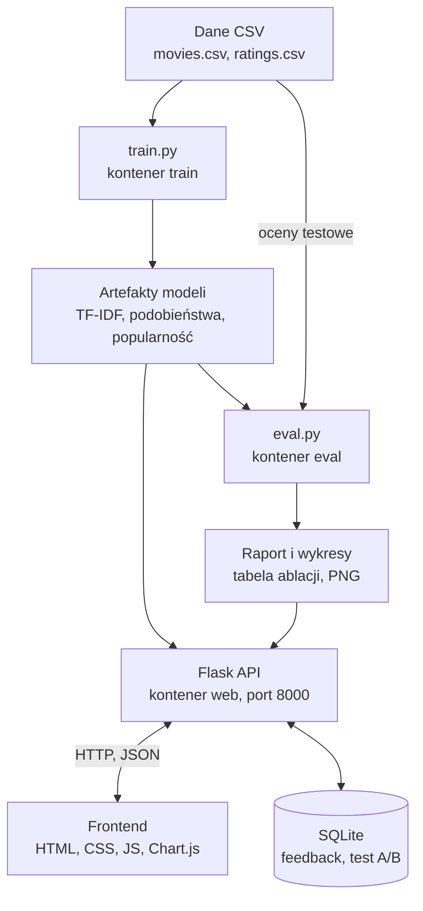

# ISI-09 · Hybryda Netflix-style z ablacją

Projekt semestralny z przedmiotu Inteligentne Systemy Internetowe (moduł B.1, tor 2). Grupa 3, docelowa ocena 5.0.

**Zespół:** Damian Kania, Kamil Krawczyk, Patryk Długosz

> Status: w budowie. README opisuje plan projektu i będzie uzupełniane razem z kodem.

## O projekcie

Rekomender filmów łączący dwa podejścia:

- **content-based**: TF-IDF na opisach i gatunkach filmów (lab 2);
- **collaborative filtering**: user-based na ocenach użytkowników (lab 3).

Ablacją mierzymy, ile jakości wnosi każdy składnik hybrydy. Demo na obronę: wyłączamy CF i pokazujemy spadek precision@5.

## Funkcjonalności

Każda ocena obejmuje funkcjonalności z ocen niższych.

| Ocena | Funkcjonalności | Stan |
|---|---|---|
| 3.0 | Silnik content-based (TF-IDF) i collaborative filtering (parametr k), baseline popularnościowy, hybryda obu silników. UI: wybór użytkownika, przełącznik silnika, suwak wagi hybrydy. | ⬜ |
| 3.5 | Podział danych po czasie (80/20), precision@5 oraz recall@5 i nDCG@5, panel metryk w UI. | ⬜ |
| 4.0 | Tabela ablacji (bez CF, bez content, bez popularności, bez centrowania ocen). Cold start: nowy użytkownik wybiera 3 filmy i od razu dostaje rekomendacje. | ⬜ |
| 4.5 | Test A/B w UI (hybryda kontra sam CF), przyciski „lubię / nie lubię”, wyniki dla każdego wariantu. | ⬜ |
| 5.0 | Raport na 4 strony z wykresami: precision@5 od wagi i od liczby sąsiadów, cold start, interpretacja ablacji. | ⬜ |

## Stack technologiczny

| Warstwa | Technologia |
|---|---|
| Frontend | HTML, CSS, JavaScript, Chart.js |
| Backend | Python 3.11, Flask (REST API) |
| ML | pandas, numpy, scikit-learn, joblib |
| Baza danych | SQLite (feedback, test A/B, nowi użytkownicy); filmy i oceny w plikach CSV |
| Docker | Dockerfile i docker compose: kontenery `train`, `web`, `eval` |
| Testy i repozytorium | pytest, Git, GitHub |

## Architektura

Trening i serwowanie są rozdzielone: `train.py` raz buduje macierze, a API tylko z nich korzysta.



## Planowana struktura repozytorium

| Plik lub katalog | Rola |
|---|---|
| `app.py` | Flask API i serwowanie frontendu |
| `recommender.py` | silnik content-based |
| `collaborative.py` | collaborative filtering |
| `hybrid.py` | łączenie silników i przełączniki ablacji |
| `train.py` | budowa artefaktów modeli |
| `eval.py` | podział czasowy, metryki, tabela ablacji |
| `data/` | `movies.csv`, `ratings.csv` |
| `static/`, `templates/` | frontend |
| `tests/` | testy pytest |
| `Dockerfile`, `docker-compose.yml` | konteneryzacja |

## Uruchomienie

Docelowo cała aplikacja startuje jedną komendą (trening, a po nim serwer na http://localhost:8000):

```bash
docker compose up --build
```

## Kto co robi

| Osoba | Zadania |
|---|---|
| Damian Kania | Dane (oceny z datami), collaborative filtering, podział czasowy |
| Kamil Krawczyk | Content-based, hybryda, metryki, ablacja, raport |
| Patryk Długosz | Flask API, frontend, baza SQLite, test A/B, Docker |

Wspólnie: README, wnioski z ablacji i przygotowanie obrony.
